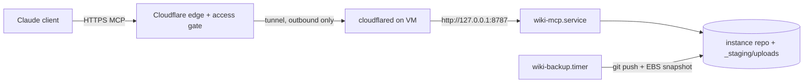

# Runbook: remote wiki server (AWS VM + Cloudflare Tunnel)

State: paper and templates only. Nothing in this repo creates a VM, a tunnel or a DNS record.
Every command below is run by a person on their own VM. Templates live in `ops/remote/`.



- The VM has no inbound port. The tunnel is outbound only; the server binds to loopback only.
- Write doors over HTTP (capture, `/upload`, `wiki_ingest_file`) stay **refused** until auth exists.
  Owner decisions D-1/D-2 (auth design) are still pending. See "Write access" below.
- Read tools (search, resolve, read text, context pack, `wiki_retrieve`) work from day one.

## 0. Values you decide once

| Placeholder | Meaning |
|---|---|
| `@PREFIX@` | the instance prefix (the one used at instantiation) |
| `@OWNER_DOMAIN@` | a domain you control in Cloudflare; host `brain.@OWNER_DOMAIN@` |
| `@TUNNEL_ID@` | only for the config-file variant of the tunnel |

Render templates with, for example:
`sed -e 's/@PREFIX@/<prefix>/g' ops/remote/wiki-mcp.service | sudo tee /etc/systemd/system/wiki-mcp.service`

## 1. VM

1. Ubuntu LTS, a small instance is enough to start (2 vCPU, 2-4 GB RAM).
2. Root volume and the data volume are **encrypted** EBS volumes.
3. Security group: **no inbound** rule at all, except SSH from your own IP (or use SSM only and open nothing).
4. Attach an instance role that may only call `ec2:CreateSnapshot` on the data volume (used by the backup).

## 2. Packages

```bash
sudo apt-get update && sudo apt-get install -y python3 python3-venv git curl nodejs npm
# cloudflared: install from Cloudflare's own apt/deb instructions, then check:
cloudflared --version
```

Node is only needed for QMD. Without it the portable search still works.

## 3. Service user and repo

```bash
sudo useradd --system --create-home --shell /usr/sbin/nologin wiki     # no sudo rights
sudo mkdir -p /srv/@PREFIX@-wiki && sudo chown wiki:wiki /srv/@PREFIX@-wiki
sudo -u wiki git clone <your-private-instance-remote> /srv/@PREFIX@-wiki
cd /srv/@PREFIX@-wiki
sudo -u wiki python3 -m venv .venv
sudo -u wiki .venv/bin/pip install -r requirements.txt -r requirements-governance.txt
```

The repo path is `/srv/@PREFIX@-wiki`. Keep `_originals/` and `_staging/` on the encrypted data volume.

## 4. Secrets file

```bash
sudo install -d -m 0750 -o root -g wiki /etc/@PREFIX@-wiki
sudo install -m 0600 -o root -g wiki ops/remote/wiki.env.example /etc/@PREFIX@-wiki/env
sudoedit /etc/@PREFIX@-wiki/env      # fill TUNNEL_TOKEN, BACKUP_* here, on the VM only
```

`/etc/@PREFIX@-wiki/env` is mode 0600 and is never committed. The template
`ops/remote/wiki.env.example` holds no secrets. The upload limits are set there too:
`LWK_UPLOAD_MAX_BYTES` (default 50 MB) and `LWK_UPLOAD_TTL_SECONDS` (default 24 h).

## 5. Cloudflare (by hand, in the dashboard)

1. Create a tunnel, copy its token into `TUNNEL_TOKEN` in the env file.
2. Add a public hostname `brain.@OWNER_DOMAIN@` with service `http://127.0.0.1:8787`.
3. Put an access policy (Cloudflare Access) in front of that hostname before anything else.
   The server has no login of its own yet.
4. Locally managed alternative: `ops/remote/cloudflared-config.yml.example`.

## 6. systemd units

Install the templates from `ops/remote/` (render `@PREFIX@` first):

| File | Job |
|---|---|
| `ops/remote/wiki-mcp.service` | `--transport http --profile capture --bind 127.0.0.1:8787` |
| `ops/remote/cloudflared.service` | the outbound tunnel to `http://127.0.0.1:8787` |
| `ops/remote/wiki-backup.service` + `ops/remote/wiki-backup.timer` | hourly: git push to a private remote, then EBS snapshot, via `ops/remote/wiki-backup.sh` |
| `ops/remote/wiki-validate.service` + `ops/remote/wiki-validate.timer` | nightly `scripts/wiki_validate.py --format json` |

```bash
sudo systemctl daemon-reload
sudo systemctl enable --now wiki-mcp.service cloudflared.service wiki-backup.timer wiki-validate.timer
systemctl status wiki-mcp.service cloudflared.service
```

The validate timer runs `scripts/wiki_validate.py --format json` (the kit's governance gate; it has no `--full` flag).
Read its result with `journalctl -u wiki-validate.service -n 50`.

## 7. Verify

```bash
curl -fsS http://127.0.0.1:8787/healthz                 # on the VM: {"status": "ok", ...}, no corpus data
curl -fsS https://brain.@OWNER_DOMAIN@/healthz          # from outside, through the tunnel and the gate
bash ops/remote/smoke.sh --read-only http://127.0.0.1:8787
```

`ops/remote/smoke.sh` runs healthz, status, capture, search, ingest of a fixture, retrieve. In
`--read-only` mode capture and ingest print `SKIP ... --read-only`. If the server does not advertise
`wiki_retrieve` yet, the last step prints `SKIP retrieve: tool wiki_retrieve not advertised` and does not fail.
Set `SMOKE_REQUIRE_HITS=1` once chunk indexing is on, so retrieve must find the fixture phrase.

## 8. Write access (pending D-1/D-2)

With the units above, `wiki_capture_text`, `wiki_ingest_file` and `/upload` answer `E_AUTH_REQUIRED` /
`E_UPLOAD_DISABLED` over HTTP. That is the safe default.

To run the full smoke (capture, upload, ingest) you must opt in, knowing the server then has **no auth of its own**:

1. Confirm the Cloudflare Access policy from step 5 works (an anonymous request is blocked at the edge).
2. Copy `ops/remote/wiki-mcp-insecure-local-only.conf.example` to
   `/etc/systemd/system/wiki-mcp.service.d/insecure-local-only.conf`, render `@PREFIX@`, then
   `sudo systemctl daemon-reload && sudo systemctl restart wiki-mcp.service`.
3. `bash ops/remote/smoke.sh http://127.0.0.1:8787`
4. The flag `--insecure-local-only` needs `--profile capture` and refuses any bind except 127.0.0.1.
   Remove the drop-in again when you are done, until D-1/D-2 are decided.

Uploads: `/upload` accepts only the file types the ingest door handles, up to the size cap, and hands
back a single-use `upl-` ref that expires after the TTL. Expired and used-up files are removed by
the next upload, or on demand with `python scripts/upload/store.py /srv/@PREFIX@-wiki`.

## 9. Roll back

- Stop exposure first: `sudo systemctl disable --now cloudflared.service` (the site disappears from the edge; the VM was never open).
- Remove the write drop-in: `sudo rm /etc/systemd/system/wiki-mcp.service.d/insecure-local-only.conf`, then `daemon-reload` and restart.
- Bad ingest: the repo is git, revert the commit; `_originals/` is append-only, so restore from the last EBS snapshot only if bytes were damaged.
- Bad config: `systemctl disable --now wiki-mcp.service`, fix, `systemctl enable --now`.

## 10. What can go wrong

| Symptom | Likely cause | Fix |
|---|---|---|
| `/healthz` fine on the VM, 502 from outside | tunnel not running or wrong service URL | `systemctl status cloudflared`, check dashboard service is `http://127.0.0.1:8787` |
| `E_AUTH_REQUIRED` on capture | write door closed (correct default) | section 8 |
| `E_UPLOAD_EXPIRED` / `E_UPLOAD_USED` | ref older than TTL, or already ingested | upload again |
| upload answers 413 | file above `LWK_UPLOAD_MAX_BYTES` | raise the value in the env file, restart |
| backup says `SKIP` | `BACKUP_*` not set | fill them in the env file |

## 11. Out of scope here

Auth and per-caller scopes (H3, blocked by D-1), the real VM, DNS and Cloudflare account setup.
